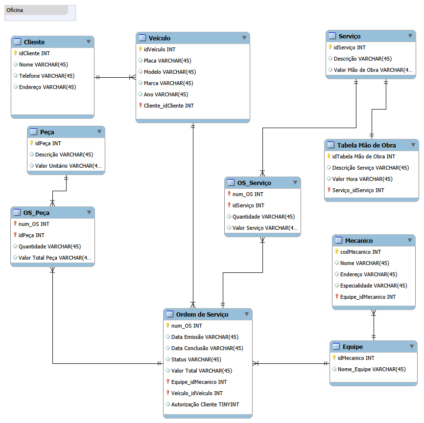

# 🔧 Banco de Dados para Oficina Mecânica

<p align="center">
  
  
  
  
</p>

---

## 📌 Descrição

Projeto desenvolvido durante a formação SQL Database Specialist da DIO com o objetivo de modelar e implementar um banco de dados para gerenciamento de uma oficina mecânica.

O sistema contempla clientes, veículos, equipes de mecânicos, ordens de serviço, serviços executados e peças utilizadas nos reparos.

Além da modelagem conceitual e lógica, foi realizada a implementação física em MySQL, inserção de dados para testes e desenvolvimento de consultas SQL para análise das informações.

---

## 📸 Visão Geral do Modelo

Abaixo está o Diagrama Entidade-Relacionamento (DER) utilizado na implementação do banco de dados.

<p align="center">
  
</p>

O modelo representa os principais relacionamentos envolvidos no fluxo operacional de uma oficina mecânica.

---

## 🎯 Objetivos do Projeto

- Construir o modelo conceitual do sistema;
- Desenvolver o modelo lógico relacional;
- Implementar o banco de dados em MySQL;
- Inserir dados para validação;
- Desenvolver consultas SQL;
- Validar os relacionamentos entre as entidades.

---

## 🏗️ Estrutura do Banco de Dados

O projeto contempla entidades relacionadas a:

### Clientes

- Clientes

### Veículos

- Veículos

### Mecânicos

- Mecânicos
- Equipes

### Ordens de Serviço

- Ordens de Serviço
- Serviços Executados

### Peças

- Peças utilizadas nos reparos

---

## 🧩 Regras de Negócio Implementadas

### ✅ Controle de Ordens de Serviço

Cada ordem de serviço possui:

- Data de emissão;
- Status;
- Valor;
- Equipe responsável.

---

### ✅ Associação entre Veículos e Clientes

Os veículos são vinculados aos respectivos clientes proprietários.

---

### ✅ Controle de Serviços e Peças

O sistema permite registrar:

- Serviços executados;
- Peças utilizadas;
- Custos envolvidos nos reparos.

---

## 🛠️ Tecnologias Utilizadas

- MySQL
- SQL
- MySQL Workbench
- Git
- GitHub

---

## 📂 Estrutura do Projeto

```text
modelo-conceitual-oficina-mecanica
│
├── README.md
├── oficina.sql
├── Oficina.mwb
└── oficina-sql.png
```

### 📄 oficina.sql

Arquivo contendo:

- Criação do banco de dados;
- Criação das tabelas;
- Definição dos relacionamentos;
- Inserção dos dados para testes;
- Consultas SQL.

### 📄 Oficina.mwb

Arquivo do modelo desenvolvido no MySQL Workbench.

### 🖼️ oficina-sql.png

Imagem do Diagrama Entidade-Relacionamento (DER).

---

## 🔍 Consultas Desenvolvidas

O projeto contempla consultas utilizando:

- SELECT
- WHERE
- ORDER BY
- HAVING
- JOIN
- CASE
- COUNT()

---

## 📊 Exemplos de Consultas

Entre as análises realizadas estão:

- Ordens de serviço por cliente;
- Veículos cadastrados;
- Serviços executados;
- Equipes responsáveis pelos reparos;
- Relação entre ordens de serviço e peças utilizadas;
- Controle e acompanhamento do status das ordens.

---

## ✅ Resultados

O banco de dados foi implementado com sucesso em MySQL.

Foram realizados:

✅ Modelagem conceitual;

✅ Modelagem lógica;

✅ Implementação física;

✅ Inserção de dados para testes;

✅ Desenvolvimento de consultas SQL;

✅ Validação dos relacionamentos.

---

## 🚀 Competências Demonstradas

- Modelagem Conceitual
- Modelagem Lógica
- Banco de Dados Relacional
- SQL
- MySQL
- MySQL Workbench
- Relacionamentos entre Entidades
- Chaves Primárias e Estrangeiras
- Consultas SQL
- Regras de Negócio
- Documentação Técnica

---

## 👨‍💻 Autor

**Rodrigo Oliveira**

🔗 LinkedIn:  
https://www.linkedin.com/in/rodrigooliveira89

🔗 GitHub:  
https://github.com/Ro-Oliveira89

---

## 📚 Formação Relacionada

Projeto desenvolvido durante a formação **SQL Database Specialist** da DIO.

---

## 📌 Status do Projeto

✅ Concluído

✅ Documentado

✅ Publicado no GitHub

✅ Validado em MySQL
